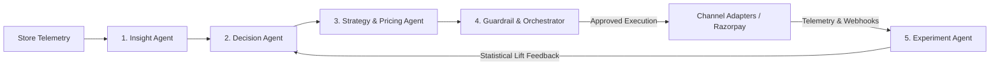

# 🚀 GrowthPilot — Autonomous AI Commerce Growth Agent System

> *"Your autonomous e-commerce growth team — finds the opportunity, decides the play, guides the execution, and measures the outcome."*

[](https://fastapi.tiangolo.com)
[](https://www.python.org/)
[](https://supabase.com/)
[](https://redis.io/)
[](https://razorpay.com/)
[-brightgreen.svg?style=flat)](#-testing--validation)
[](LICENSE)

---

## 📖 Table of Contents
- [Executive Overview](#-executive-overview)
- [The Problem: The Analytics-to-Action Gap](#-the-problem-the-analytics-to-action-gap)
- [System Architecture](#-system-architecture)
- [SaaS Seller Growth Command Center (8 Modules)](#-saas-seller-growth-command-center-8-modules)
  - [1. Executive Business Overview](#1-executive-business-overview)
  - [2. Customer Intelligence & RFM Segmentation](#2-customer-intelligence--rfm-segmentation)
  - [3. Product Analytics & Performance Matrix](#3-product-analytics--performance-matrix)
  - [4. Explainable AI Growth Opportunities](#4-explainable-ai-growth-opportunities)
  - [5. Guided 8-Step Campaign Builder & Performance Dashboard](#5-guided-8-step-campaign-builder--performance-dashboard)
  - [6. A/B Testing & Continuous Learning Loop](#6-ab-testing--continuous-learning-loop)
  - [7. Conversational AI Growth Copilot](#7-conversational-ai-growth-copilot)
  - [8. System Audit & Testing Workbench](#8-system-audit--testing-workbench)
- [Multi-Agent Core & Decision Engine](#-multi-agent-core--decision-engine)
- [Mathematical Rigor & Zero Hallucination](#-mathematical-rigor--zero-hallucination)
- [Simulation Transparency & Channel Honesty](#-simulation-transparency--channel-honesty)
- [Quickstart & 60-Second Setup](#-quickstart--60-second-setup)
- [API Reference](#-complete-api-reference)
- [Testing & Validation](#-testing--validation)
- [Project Directory Structure](#-directory-structure)

---

## 🎯 Executive Overview

**GrowthPilot** is an autonomous, multi-agent AI growth engineering system for e-commerce brands and D2C sellers. It bridges the critical divide between **passive analytics** and **commercial execution**.

Traditional dashboards dump charts on store owners without guidance. GrowthPilot closes the loop:
1. **Telemetry Ingestion**: Scans live storefront event streams (pageviews, cart additions, drop-offs, checkouts).
2. **Bottleneck Detection**: Diagnoses drop-offs and flags churn risks using statistical models.
3. **Explainable Opportunity Scoring**: Prioritizes growth plays with a normalized 4-factor scoring model ($0.35I + 0.25C + 0.20F + 0.20E$).
4. **Deterministic Guardrails**: Enforces margin floors, discount ceilings, and budget caps to protect profitability.
5. **Guided Campaign Builder**: An 8-step wizard offering AI multi-variant copywriting, audience sizing, and channel previews.
6. **Honest Multi-Mode Execution**: Transparent Demo Mode simulation (`[SIMULATED]`) alongside authenticated Live Mode rails.
7. **Causal Measurement**: Runs two-proportion Z-tests and Welch's t-tests to prove causal revenue lift and feeds results back into future strategy weights.
8. **Conversational Copilot**: Natural-language assistant that answers business questions using verified telemetry and authorized analytics.

---

## ⚡ The Problem: The Analytics-to-Action Gap

```
┌──────────────────────────────────────┐
│        Traditional Dashboards        │  ❌ Passive & Ambiguous
│ "Cart abandonment reached 71% for    │     Leaves merchant guessing what offer,
│  Earbud Stands in 18-25 cohort"      │     what copy, and what margin to risk.
└──────────────────┬───────────────────┘
                   │
         [ANALYTICS-TO-ACTION GAP]
                   │
┌──────────────────▼───────────────────┐
│         GrowthPilot Solution         │  ✅ Autonomous, Explainable & Gated
│ Multi-agent intelligence scores play │     Pre-calculates 8% discount (42% margin),
│ (Priority 89.2), generates 6 copy   │     validates GR-01/02/03/06 guardrails,
│ variants, and tracks causal lift.    │     and guides execution with full audit trail.
└──────────────────────────────────────┘
```

---

## 🏗️ System Architecture

GrowthPilot is built on a 4-Tier Enterprise Architecture combining asynchronous processing, multi-tenant database isolation, in-memory event queues, and deterministic mathematical validation.

```
┌────────────────────────────────────────────────────────────────────────┐
│                        TIER 1: PRESENTATION                            │
│  Seller Growth Command Center (Tailwind CSS, Chart.js, Vanilla JS)     │
│  8 Views · INR Formatting · Loading Skeletons · Honest Demo/Live Mode  │
└───────────────────────────────────┬────────────────────────────────────┘
                                    │ HTTP / REST / JSON
┌───────────────────────────────────▼────────────────────────────────────┐
│                    TIER 2: GATEWAY & GOVERNANCE                        │
│  FastAPI · PyJWT Multi-Tenant Auth · Sliding-Window Rate Limiter       │
│  Server-Side Tenant Extraction (No Client-Spoofing)                    │
└───────────────────────────────────┬────────────────────────────────────┘
                                    │
┌───────────────────────────────────▼────────────────────────────────────┐
│                  TIER 3: MULTI-AGENT INTELLIGENCE                      │
│  Insight Agent ──► Decision Agent ──► Strategy & Pricing Agent         │
│  ▲                         │                                           │
│  │ Causal Learning Loop    ▼                                           │
│  Experiment Agent  ◄── Guardrail & Orchestration Agent                 │
│  (Two-Prop Z-Test)     (Margin Floors, Discount Ceilings, Risk Tiers)  │
└───────────────────────────────────┬────────────────────────────────────┘
                                    │
┌───────────────────────────────────▼────────────────────────────────────┐
│                    TIER 4: PERSISTENCE & ADAPTERS                      │
│  SQLite WAL / PostgreSQL (Supabase RLS) · Redis Queue · Razorpay Rails │
│  SimulatedAdapter (Demo Mode) · LiveAdapter (SendGrid / SMTP Rails)    │
└────────────────────────────────────────────────────────────────────────┘
```

---

## 🖥️ SaaS Seller Growth Command Center (8 Modules)

The merchant portal is structured into 8 purpose-built views designed for non-technical store owners:

### 1. Executive Business Overview
- **Core KPI Cards**: Total Revenue (₹), Total Orders, Average Order Value (AOV), Conversion Rate (%), Returning Customer Rate (%), and Revenue Growth vs previous period.
- **Visual Analytics**: Interactive 30-day Revenue Trend line chart, Orders Trend bar chart, Category Revenue breakdown donut, Top-Selling Products table, and Recent Activity log.
- **Date Presets**: `Today`, `Last 7 Days`, `Last 30 Days`, `Last 90 Days`, and `Custom Range`.

### 2. Customer Intelligence & RFM Segmentation
- **Segmentation Engine**: Categorizes buyers into `Champions`, `Loyal Customers`, `Potential Loyalists`, `New Customers`, `At Risk`, and `Lost Customers`.
- **Behavioral Visualizations**: RFM segmentation distribution, churn risk breakdown, Customer Lifetime Value (CLV) cohorts, and spending trend curves.
- **Customer Table**: Searchable, sortable, and filterable customer roster showing Segment, Total Spent (₹), Last Purchase Date, Churn Risk score, and Recommended Action.

### 3. Product Analytics & Performance Matrix
- **Comprehensive Financials**: Revenue by Product bar chart, 30-day Sales Velocity trends, and Gross Margin Analysis with cost/margin tiers.
- **4-Quadrant BCG Matrix**: Classifies inventory into *Stars*, *Cash Cows*, *Question Marks*, and *Dogs*.
- **Diagnosis Tables**: Top-Selling Products with velocity indicators and Underperforming Products with AI diagnosis.
- **Conditional Inventory Alerts**: Stock warnings generated *only when inventory data exists*.
- **Clickable Product Modals**: Drill down into engagement funnels, buyer demographics, and 30-day trajectories.

### 4. Explainable AI Growth Opportunities
- **Priority Scoring**: Ranks growth opportunities using the 4-factor formula:
  $$\text{Priority} = 0.35I + 0.25C + 0.20F + 0.20E$$
- **Opportunity Cards**: Includes Title, Problem Detected, Supporting Business Data, Target Segment, Expected Revenue Lift, Priority Score, Risk Level, and Estimated Campaign Cost.
- **Opportunity Lifecycle Tracking**:
  $$\text{Detected} \longrightarrow \text{Analysed} \longrightarrow \text{Approved} \longrightarrow \text{Executing} \longrightarrow \text{Completed} \longrightarrow \text{Evaluated}$$
- **Direct Hand-off**: Every opportunity has a one-click **"Create Campaign in Studio"** button that transfers strategy parameters directly into the campaign builder.

### 5. Guided 8-Step Campaign Builder & Performance Dashboard
Converts campaign proposals into an 8-step guided wizard:
- **Step 1: Select Growth Opportunity** — Auto-populates from ranked opportunities or custom strategies.
- **Step 2: Select Target Audience** — Precision segment selection with live audience sizing counter (e.g. 850 customers).
- **Step 3: Choose Campaign Channels** — Real-time readiness checks. **SMS is explicitly marked as `NOT OPERATIONAL / UNSUPPORTED`** (locked and disabled) because SMS gateway credentials are not configured, maintaining 100% channel honesty.
- **Step 4: AI Content Generation** — Multi-variant copy generator creating 3 Email + 3 Push variants with deterministic character linter and dynamic merge tokens.
- **Step 5: Configure Discount, Budget & Duration** — Dynamic discount slider (3–20%), margin ceiling indicators, per-user caps, total budget, and unit economics calculator.
- **Step 6: Live Campaign Preview** — Desktop/mobile email client and smartphone push notification mockups with token resolution.
- **Step 7: Risk, Guardrails & Approval Requirements** — Automated verification of GR-01 (Margin Floor $\ge 20\%$), GR-02 (Discount Ceiling $\le 16.2\%$), GR-03 (Budget Cap $\le$ ₹50,000), and GR-06 (Batch Audience $\le 5,000$) with role-gated sign-off.
- **Step 8: Execute or Simulate Campaign** — Pre-flight checklist, Razorpay test mode verification, and execution trigger.
- **Campaign Performance Dashboard**:
  - **Messages Sent**: Total dispatches across active channels.
  - **Delivery Rate (%)**: Messages successfully delivered.
  - **Open Rate (%)**: Unique opens.
  - **Click-Through Rate (%)**: Link clicks.
  - **Conversion Rate (%)**: Orders placed.
  - **Revenue Generated (₹)**: Attributed gross sales lift.
  - **Campaign ROI (%)**: Net commercial return multiple.
  - **Delivery & Conversion Funnel**: Sent $\to$ Delivered $\to$ Opened $\to$ Clicked $\to$ Converted visual drop-off.
  - **Dispatch Telemetry Log**: Real-time sample delivery logs with delivery IDs, provider IDs, and simulation tags.

### 6. A/B Testing & Continuous Learning Loop
- **Statsig-Style Experiment Interface**:
  - **Control Arm A**: Baseline strategy (No discount).
  - **Treatment Arm B**: GrowthPilot strategy (8% personalized discount).
- **Comprehensive Measurements**: Number of customers, Conversion Rate, Revenue per Customer, Average Order Value (AOV), Profit Margin, and Campaign Cost.
- **Rigorous Causal Inference**:
  - Two-proportion hypothesis Z-test and Welch's t-test.
  - Evaluates sample size, statistical significance ($p < 0.05$), and confidence intervals before declaring a winner.
- **Autonomous Feedback Loop**: Automatically updates decision weights and model confidence based on verified results.

### 7. Conversational AI Growth Copilot
- **Natural Language Interface**: Ask plain-English business questions:
  - *"Why did my revenue decrease this month?"*
  - *"Which product has the highest cart abandonment?"*
  - *"Identify customers likely to churn."*
  - *"What was the impact of my previous campaign?"*
- **Architecture**:
  - Intent Classification $\to$ Authorized Tenant Telemetry $\to$ Analytics Execution $\to$ LLM Synthesis with empirical figures $\to$ Suggested action chips.
  - Strictly blocked from autonomously executing commercial changes without Guardrail Agent validation and human approval.

### 8. System Audit & Testing Workbench
- Dedicated testing area cleanly separated from seller-facing dashboards.
- Inspects cryptographic SHA-256 audit logs and contains test controls for simulating Razorpay webhooks (`payment.captured`, `payment.failed`).

---

## 🤖 Multi-Agent Core & Decision Engine

GrowthPilot operates 5 specialized autonomous agents working in sequence:



1. **Insight Agent**: Scans event streams, identifies funnel bottlenecks, and flags churn anomalies.
2. **Decision Agent**: Converts anomalies into quantifiable opportunities and computes priority scores.
3. **Strategy & Pricing Agent**: Formulates dynamic discount bands and generates linted multi-variant copy.
4. **Guardrail Agent**: Validates commercial policies (GR-01, GR-02, GR-03, GR-06) and enforces role-based approvals.
5. **Experiment Agent**: Performs statistical hypothesis tests on outcomes and updates decision weights.

---

## 📐 Mathematical Rigor & Zero Hallucination

> **Zero-Hallucination Guarantee**: LLMs generate creative copy, but **all financial calculations, pricing discounts, and risk approvals are governed by deterministic mathematics**.

### 1. Opportunity Priority Scoring
$$\text{Priority} = 0.35 \times I + 0.25 \times C + 0.20 \times F + 0.20 \times E$$
- $I$ = Business Impact Score ($0 - 100$, normalized from projected revenue lift)
- $C$ = Confidence Score ($0 - 100$, grounded in telemetry sample size)
- $F$ = Feasibility Score ($0 - 100$, execution ease and channel availability)
- $E$ = Urgency Score ($0 - 100$, drop-off recency and inventory velocity)

### 2. Churn Propensity Scoring
$$\text{Churn Risk} = 0.50 \times \text{Recency} + 0.30 \times \text{Session Inactivity} + 0.20 \times \text{Order Frequency}$$
Customers with a score $> 0.70$ are flagged as high churn risk.

### 3. Deterministic Dynamic Discount Band
$$\text{Margin Floor} = \text{Product Margin \%} - \text{Discount \%} \ge 20.0\%$$
$$\text{Dynamic Discount Ceiling} = \min\left(25.0\%, \max\left(5.0\%, \text{Product Margin \%} \times 0.25 \times \text{Urgency}\right)\right)$$
*Example (Earbud Stand with 50% margin & 1.3 urgency):* Ceiling is **16.2%**, Recommended Offer is **8.0%**, maintaining a **42.0%** post-discount margin.

### 4. Two-Proportion Hypothesis Z-Test
$$p_{\text{pool}} = \frac{x_A + x_B}{n_A + n_B}, \quad SE = \sqrt{p_{\text{pool}}(1 - p_{\text{pool}})\left(\frac{1}{n_A} + \frac{1}{n_B}\right)}, \quad Z = \frac{p_B - p_A}{SE}$$
Validates whether conversion lift is statistically significant ($p < 0.05, |Z| > 1.96$) or due to random variance.

---

## 🛡️ Simulation Transparency & Channel Honesty

GrowthPilot communicates execution reality honestly:

1. **Demo Mode vs. Live Mode**:
   - **Demo Mode**: Dispatches simulated multi-channel telemetry. Every delivery event, receipt, and analytics card is explicitly tagged <strong style="color:#d97706">[SIMULATED]</strong>.
   - **Live Mode**: Dispatches real messages via configured provider credentials (`SENDGRID_API_KEY`, `SMTP_HOST`). If credentials are not configured, the system safely refuses execution with code `LIVE_ADAPTER_UNAVAILABLE`.
2. **Channel Integrity**:
   - Supported and configured channels (Email, WebPush) are marked **Operational**.
   - Channels lacking credentials (e.g. **SMS**) are displayed as **`NOT OPERATIONAL / UNSUPPORTED`** and locked. GrowthPilot never falsely marks unconfigured channels as operational.

---

## ⚡ Quickstart & 60-Second Setup

### Prerequisites
- Python 3.10+
- (Optional) Docker or local Redis & Supabase. If omitted, GrowthPilot automatically runs offline with zero configuration using **SQLite WAL** and **in-memory Fakeredis**.

### 1. Clone & Set Up Virtual Environment
```bash
git clone https://github.com/your-username/Growth_pilot.git
cd Growth_pilot

# Create virtual environment
python -m venv venv

# Activate virtual environment
# Windows:
.\venv\Scripts\activate
# Linux/macOS:
source venv/bin/activate

# Install dependencies
pip install -r requirements.txt
```

### 2. Configure Environment (Optional)
```bash
cp .env.example .env
```
Default configuration works out of the box with zero external dependencies.

### 3. One-Click Launcher
```bash
python run_growthpilot.py
```
This automatically:
1. Seeds 6 months of multi-tenant e-commerce telemetry for both stores.
2. Executes the multi-agent pipeline to generate fresh opportunities.
3. Launches the FastAPI server at `http://127.0.0.1:8000`.

- **Web Dashboard**: [http://127.0.0.1:8000/](http://127.0.0.1:8000/)
- **Swagger API Docs**: [http://127.0.0.1:8000/docs](http://127.0.0.1:8000/docs)
- **Demo Accounts**:
  - Store Alpha: **SoundWave Audio** (`tenant_store_alpha`) — Consumer Electronics
  - Store Beta: **PulseWear** (`tenant_store_beta`) — Smart Wearables

---

## 📡 Complete API Reference

| Domain | Method | Endpoint | Description |
|---|---|---|---|
| **Auth** | `POST` | `/api/auth/demo-login` | 1-Click login for Store Alpha or Beta |
| **Auth** | `GET` | `/api/auth/me` | Authenticated tenant profile & role |
| **Overview** | `GET` | `/api/overview` | Core KPIs, revenue trends, and category distribution |
| **Customers** | `GET` | `/api/v1/customers` | Searchable, paginated customer intelligence roster |
| **Customers** | `GET` | `/api/v1/customers/segments` | RFM segmentation distribution cohorts |
| **Customers** | `GET` | `/api/v1/customers/churn-risk` | High churn risk customer predictions |
| **Products** | `GET` | `/api/v1/products/analytics` | BCG performance matrix, margin analysis, trends |
| **Products** | `GET` | `/api/v1/products/{id}` | Clickable product detail and engagement funnel |
| **Opportunities**| `GET` | `/api/v1/opportunities` | Prioritized opportunities scored by 4-factor formula |
| **Opportunities**| `GET` | `/api/v1/opportunities/analytics` | Opportunity categories and revenue comparisons |
| **Campaigns** | `POST` | `/api/v1/campaigns` | Create campaign draft from opportunity or custom |
| **Campaigns** | `GET` | `/api/v1/campaigns/channels/readiness` | Channel connectivity status (Email, Push, SMS) |
| **Campaigns** | `POST` | `/api/v1/campaigns/{id}/generate-content`| Generate 3 Email + 3 Push linted copy variants |
| **Campaigns** | `GET` | `/api/v1/campaigns/{id}/preview` | Resolve personalization tokens for sample customer |
| **Campaigns** | `POST` | `/api/v1/campaigns/{id}/approve` | Guardrail validation & role-gated approval sign-off |
| **Campaigns** | `POST` | `/api/v1/campaigns/{id}/execute` | Dispatch execution (Demo simulation vs. Live rails)|
| **Campaigns** | `GET` | `/api/v1/campaigns/{id}/performance` | 7 core KPIs: sends, rates, revenue, and ROI |
| **Experiments**| `GET` | `/api/v1/experiments` | List A/B tests with statistical significance |
| **Experiments**| `POST` | `/api/v1/experiments/{id}/evaluate` | Execute two-proportion Z-test & Welch's t-test |
| **Copilot** | `POST` | `/api/v1/copilot/chat` | Conversational query execution with guardrail gating |
| **Audit** | `GET` | `/api/audit-log` | Tamper-evident log with SHA-256 payload hashes |
| **Webhooks** | `POST` | `/api/webhooks/razorpay` | HMAC-SHA256 verified Razorpay event receiver |

---

## 🧪 Testing & Validation

The test suite covers unit economics, agent orchestration, guardrail enforcement, multi-tenant isolation, and statistical significance:

```bash
python -m pytest tests/ -v
```

### Test Suite Status: **93 / 93 Passed (100% Pass Rate)** ✅

- `tests/test_growthpilot.py`: Core scoring, RFM models, churn formulas, and pipeline flow.
- `tests/test_module_a_analytics.py`: Executive KPIs, date filtering, and statutory metrics.
- `tests/test_module_b_agents.py`: Multi-agent pipeline, deterministic guardrails, and role gating.
- `tests/test_module_c_opportunities.py`: 4-factor opportunity scoring, opportunity analytics, and ranking.
- `tests/test_module_d_campaigns.py`: 8-step builder, channel readiness, copy linter, approval gating, and ROI metrics.
- `tests/test_module_e_experiments.py`: Two-proportion Z-tests, Welch's t-tests, sample size checks, and learning loop.
- `tests/test_phase1_schema_audit.py`: SQLite WAL schema integrity, foreign keys, and indexes.
- `tests/test_phase2_postgres_redis.py`: Dual-mode persistence, Redis queueing, and webhook caching.
- `tests/test_phase3_multi_tenant_auth.py`: JWT claims verification, RLS policies, and cross-tenant isolation.
- `tests/test_razorpay.py`: Razorpay test orders, payment link creation, and webhook verification.

---

## 📁 Directory Structure

```
Growth_pilot/
├── backend/
│   └── app/
│       ├── agents/                  # Autonomous Multi-Agent Core
│       │   ├── insight_agent.py     # Anomaly and churn detection
│       │   ├── decision_agent.py    # Opportunity scoring and ranking
│       │   ├── strategy_agent.py    # Opportunity seeding and prioritization
│       │   ├── campaign_agent.py    # Pricing and multi-variant copy generator
│       │   ├── guardrail_agent.py   # Margin floor & ceiling policy enforcement
│       │   ├── orchestrator.py      # Pipeline coordinator & Razorpay dispatch
│       │   └── experiment_agent.py  # Two-proportion Z-test statistical evaluator
│       ├── analytics/               # Analytics Computation Engines
│       │   ├── product_analytics.py # BCG matrix, margins, sales velocity
│       │   ├── customer_analytics.py# RFM segmentation, churn propensity
│       │   └── overview_analytics.py# Executive KPIs, trends, date filtering
│       ├── api/                     # REST API Routing (v1 modular routers)
│       │   ├── routes.py            # Overview, legacy routes, webhook endpoints
│       │   ├── opportunity_routes.py# Opportunity feed and analytics
│       │   ├── campaign_routes.py   # 8-step campaign builder and execution
│       │   ├── customer_routes.py   # Customer intelligence and RFM endpoints
│       │   ├── product_routes.py    # Product intelligence and BCG matrix
│       │   ├── experiment_routes.py # A/B testing and statistical evaluation
│       │   └── copilot_routes.py    # Natural-language copilot and intent engine
│       ├── auth/                    # Multi-Tenant Authentication
│       │   ├── jwt_auth.py          # PyJWT token generator and validator
│       │   └── dependencies.py      # Server-side tenant and user extractor
│       ├── campaigns/               # Delivery Adapters & Channel Integrations
│       │   ├── service.py           # Campaign lifecycle and performance engine
│       │   ├── adapters.py          # SimulatedAdapter vs. LiveAdapter (SendGrid/SMTP)
│       │   └── schemas.py           # Pydantic validation schemas
│       ├── db/                      # Persistence Layer
│       │   ├── models.py            # SQLite/Postgres schema (12 relational tables)
│       │   ├── database.py          # SQLAlchemy dual engine & Supabase RLS
│       │   └── seed_synthetic_data.py # 6-month synthetic multi-tenant dataset
│       └── main.py                  # FastAPI server entrypoint
├── frontend/                        # Seller Growth Command Center UI
│   ├── index.html                   # Single-Page Application (8 views, Chart.js)
│   └── login.html                   # Multi-tenant 1-click store selector
├── tests/                           # Automated Test Suite (93 tests, 100% passing)
├── run_growthpilot.py               # 1-Click CLI launcher
├── requirements.txt                 # Python dependencies
├── .env.example                     # Environment template
└── README.md                        # Project documentation
```

---

## 🏆 Key Differentiators for Hackathon Reviewers

1. **Closed-Loop Commerce**: Goes beyond passive analytics by connecting telemetry diagnosis, mathematical opportunity scoring, guardrail verification, campaign execution, and statistical validation in a single platform.
2. **Zero-Hallucination Pricing**: Disallows LLMs from deciding financial terms. All discounts, margin floors, and budget limits are calculated using deterministic mathematics.
3. **Honest Engineering**: Clearly distinguishes Demo Mode (`[SIMULATED]`) from authentic Live Mode rails, and locks unsupported integrations (such as SMS) to prevent false claims.
4. **Causal Statistical Rigor**: Validates campaign lift using two-proportion Z-tests and Welch's t-tests, updating future strategy confidence based on empirical results.
5. **Production Multi-Tenancy**: Built with server-verified JWT claims, Row Level Security, sliding-window rate limiting, and tamper-evident SHA-256 audit logs.
